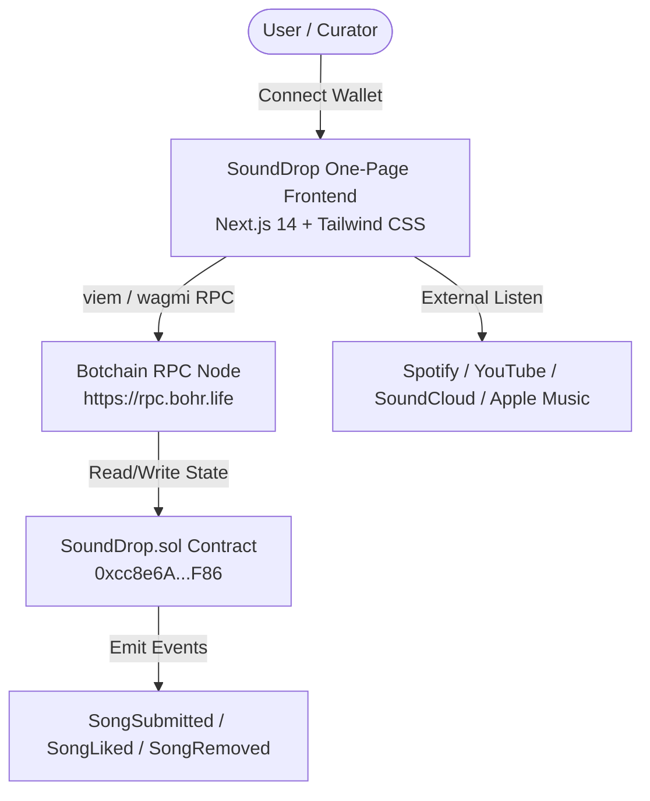

# SoundDrop ⚡ Whitepaper & Pitch Deck

**Platform:** SoundDrop  
**Tagline:** *"Discover. Share. Repeat."*  
**Network:** Botchain Testnet (`Chain ID: 968`)  
**Verified Contract:** [`0xcc8e6A07bc99f3C0c64116F84c66dcaAFA359F86`](https://scan.bohr.life/address/0xcc8e6A07bc99f3C0c64116F84c66dcaAFA359F86#code)  
**Repository:** [https://github.com/liljhnxn/sounddrop.git](https://github.com/liljhnxn/sounddrop.git)  
**Status:** Live & Deployed  

---

## 1. Executive Summary

**SoundDrop** is a decentralized, permissionless music-discovery protocol built on the Botchain network. It connects listeners, curators, and independent artists in an open ecosystem where song recommendations and upvotes are immutably preserved on-chain. 

Unlike traditional streaming monopolies that rely on opaque, payola-driven algorithms, SoundDrop restores organic, community-led music discovery. By eliminating backend databases, platform tokens, and speculative barriers, SoundDrop delivers a pure, frictionless Web3 utility designed for mainstream music lovers.

---

## 2. The Problem

The modern digital music discovery experience is broken:

1. **Algorithmic Monopolies & Payola**: Streaming giants prioritize major labels and sponsor-backed tracks. Real organic discovery has been replaced by calculated engagement loops.
2. **Platform Siloing**: Playlists are locked inside proprietary walled gardens (Spotify, Apple Music, YouTube Music). There is no universal, neutral hub where music from all streaming platforms can be shared and aggregated.
3. **Ephemeral Social Curation**: Recommendations on Twitter, Reddit, or Discord disappear within hours down the feed. There is no permanent, public ledger of community music taste.
4. **Web3 Friction & Token Over-Engineering**: Most music Web3 projects force speculative tokens, expensive NFTs, or complex staking mechanisms before users can listen or vote.

---

## 3. The SoundDrop Solution

SoundDrop addresses these shortcomings through radical simplicity and on-chain immutability:

- **100% On-Chain State**: Every drop, like count, platform identifier, and author timestamp is stored directly in the `SoundDrop.sol` smart contract on Botchain.
- **Cross-Platform Aggregation**: Users can submit and discover direct links to Spotify, YouTube, SoundCloud, Apple Music, Bandcamp, and independent platforms.
- **Zero Token / Zero Speculation**: No token gates, no inflation, no volatility. Any user with a Web3 wallet (MetaMask) can participate immediately.
- **Sybil-Resistant On-Chain Likes**: Upvotes are permanently tracked per wallet address, preventing spam or duplicate likes while allowing transparent listener sentiment.
- **Author Sovereignty**: Submitters retain absolute authority over their drops and can deactivate their submissions on-chain at any time.

---

## 4. Product Architecture

SoundDrop is engineered under strict architectural purity: **Exactly One Webpage** and **Exactly One Smart Contract**, with **zero centralized backends or databases**.



### Key Technical Characteristics:
- **Frontend Framework**: Next.js 14 (App Router) with single-page layout (`src/app/page.tsx`).
- **Styling Architecture**: Custom dark music-player aesthetic (`#0B0B0D` background, `#18181B` cards, `#DFFF00` electric lime accent).
- **Web3 Connectivity**: `wagmi v2` + `viem` with auto-chain switching to Botchain Testnet (`Chain ID: 968`).
- **Contract Language**: Solidity `^0.8.20` with custom gas-optimized errors and batch view methods (`batchHasLiked`, `getStats`).

---

## 5. Smart Contract Deep Dive: `SoundDrop.sol`

The smart contract acts as the autonomous backend, data store, and business logic engine.

### Data Structures & State Model:

```solidity
struct Song {
    uint256 id;
    string title;
    string artist;
    string platform;     // Spotify, YouTube, SoundCloud, Apple Music, etc.
    string url;          // Direct playback URL
    string description;  // Optional listener review/curation note
    address author;      // Submitter's wallet address
    uint256 timestamp;   // Submission block timestamp
    uint256 likeCount;   // Verified likes counter
    bool isActive;       // Active or removed status
}
```

### Core Methods:

| Method | Access | Description |
| :--- | :--- | :--- |
| `submitSong(...)` | Public | Submits a song with title, artist, platform, url, and optional review. Emits `SongSubmitted`. |
| `likeSong(uint256 id)` | Public | Upvotes a song. Strictly prevents duplicate likes from the same wallet address. Emits `SongLiked`. |
| `unlikeSong(uint256 id)` | Public | Allows users to withdraw an upvote, updating global and song-level stats. Emits `SongUnliked`. |
| `removeSong(uint256 id)` | Author Only | Allows the original author to deactivate their drop. Emits `SongRemoved`. |
| `getAllSongs()` | View | Returns full list of all submitted drops. |
| `getActiveSongs()` | View | Returns only currently active drops. |
| `batchHasLiked(...)` | View | High-performance multicall helper for instant UI heart states in a single RPC query. |
| `getStats()` | View | Returns global counts: total submissions, active drops, and cumulative likes. |

---

## 6. Pitch Deck: Slide Breakdown

### Slide 1: Cover & Mission
- **Title**: SoundDrop ⚡
- **Subtitle**: Decentralized Music Discovery on Botchain
- **Tagline**: *"Discover. Share. Repeat."*

### Slide 2: The Opportunity
- 100,000+ songs are released every day. Over 80% never get discovered due to algorithmic gatekeeping.
- Music lovers crave genuine peer recommendations rather than sponsored commercial playlists.

### Slide 3: The Solution
- A neutral, on-chain music recommendation protocol where music discovery is democratic, transparent, and permanent.
- Links out to where listeners already listen (Spotify, YouTube, SoundCloud).

### Slide 4: Key Differentiators
- **Zero Middlemen**: 100% decentralized state on Botchain.
- **Zero Token Fatigue**: Pure utility dApp accessible to any Web3 user.
- **Electric Aesthetic**: Polished, dark music-player UI inspired by modern audio gear.

### Slide 5: Live Traction & Verification
- **Testnet Contract**: Fully verified on Botchain block explorer.
- **100% Test Coverage**: 16/16 unit tests passing across all state transitions.
- **Open Source**: Complete code published on GitHub.

### Slide 6: Roadmap
- **Q1 2027**: Mainnet Deployment on Botchain; Native tipping module for curating users.
- **Q2 2027**: Mobile PWA (Progressive Web App) with in-app audio preview widgets.
- **Q3 2027**: Collaborative on-chain playlists and curator reputation scores.

---

## 7. Ecosystem Value for Botchain

SoundDrop is a premier consumer showcase for the Botchain ecosystem:
1. **High Daily Active Transactions**: Every song submission, like, unlike, and removal generates authentic on-chain transactions on Botchain.
2. **Mainstream Onboarding**: Appeals to non-speculative, everyday users who simply love good music.
3. **Ecosystem Composability**: Can integrate seamlessly with future Botchain identity, social graph, and creator tipping standards.

---

## 8. Verification & Resource Links

- **Block Explorer Verified Contract:** [https://scan.bohr.life/address/0xcc8e6A07bc99f3C0c64116F84c66dcaAFA359F86#code](https://scan.bohr.life/address/0xcc8e6A07bc99f3C0c64116F84c66dcaAFA359F86#code)
- **GitHub Repository:** [https://github.com/liljhnxn/sounddrop.git](https://github.com/liljhnxn/sounddrop.git)
- **Network RPC:** `https://rpc.bohr.life`
- **Chain ID:** `968`

---
*© 2026 SoundDrop Protocol. Built on Botchain.*
